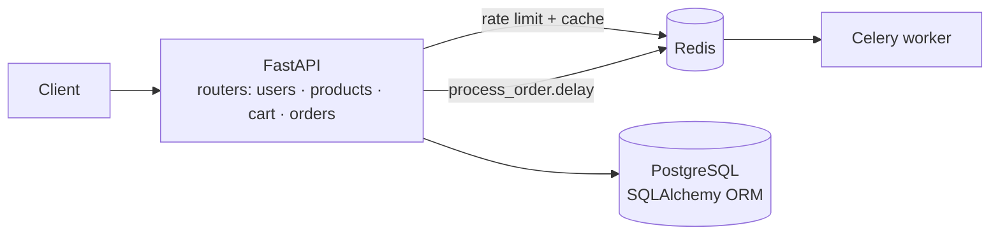

<div align="center">

# 🛒 E-Commerce Backend

**A REST API for an online store: products, carts and orders. It uses JWT auth, Redis-backed caching and rate limiting, and Celery background jobs.**

[](https://github.com/rohantiwari9573/ecommerce-backend/actions/workflows/ci.yml)


**[Live API docs (Swagger)](https://ecommerce-backend-spj8.onrender.com/docs)** · **[Health check](https://ecommerce-backend-spj8.onrender.com/health)**

<sub>Hosted on a free tier, so the first request after an idle period can take up to a minute while the service wakes up.</sub>

</div>

---

## Features

- **JWT authentication.** Signup and login issue bearer tokens that expire after 60 minutes. Passwords are hashed with bcrypt and must be at least 8 characters.
- **Product catalog.** `GET /products` is served from a Redis cache with a 60-second TTL, and the cache is invalidated as soon as a product is created, so reads never go stale.
- **Rate limiting.** A per-IP fixed window (10 requests per 60 seconds) is stored in Redis and returns `429` when exceeded. It fails open if Redis is unreachable, so a cache outage never takes the API down.
- **Carts and orders.** Users manage their own cart, and checking out turns cart items into an order with line items.
- **Background jobs.** Placing an order enqueues a `process_order` Celery task, using Redis as the broker. The task body is currently a placeholder for fulfilment work such as invoicing or notifications.
- **Operations.** The app logs every request, exposes a `/health` endpoint for uptime checks and reads all configuration from environment variables via `pydantic-settings`.

## Architecture



## API

| Method | Endpoint | Auth | Description |
|---|---|:-:|---|
| `POST` | `/signup` | | Create an account |
| `POST` | `/login` | | Get a JWT access token |
| `GET` | `/products` | | List products (cached) |
| `POST` | `/products` | | Create a product (invalidates the cache) |
| `GET` | `/cart` | 🔒 | View your cart |
| `POST` | `/cart` | 🔒 | Add an item to your cart |
| `GET` | `/orders` | 🔒 | List your orders |
| `POST` | `/orders` | 🔒 | Place an order from your cart |
| `GET` | `/health` | | Liveness probe |

Full request and response schemas are in the [Swagger UI](https://ecommerce-backend-spj8.onrender.com/docs).

## Getting started

Docker Compose brings up the API, PostgreSQL, Redis and a Celery worker:

```bash
git clone https://github.com/rohantiwari9573/ecommerce-backend.git
cd ecommerce-backend
```

Create a `.env` file:

```env
SECRET_KEY=change-me
POSTGRES_PASSWORD=change-me
DATABASE_URL=postgresql+psycopg2://postgres:change-me@db:5432/ecommerce
REDIS_URL=redis://redis:6379/0
```

```bash
docker compose up --build
```

Then open http://localhost:8000/docs. The database and Redis are only reachable on the internal Compose network and are never published to the host.

## Project structure

```text
app/
  main.py        app setup, request logging, router registration, /health
  routers/       users, products, cart, orders
  models/        SQLAlchemy models (user, product, cart, order, order_item)
  schemas/       Pydantic request/response models
  auth/          password hashing + JWT helpers
  core/          settings, Redis client, rate limiter, Celery app, logger
  tasks/         Celery tasks
```

## Deployment and CI

- **API:** Render web service (`render.yaml`).
- **Database:** Neon PostgreSQL.
- **Cache and rate limiting:** Render Key Value (Redis-compatible).
- **Celery worker:** runs in the Docker Compose setup. On the free hosting tier, orders are still enqueued, but no worker consumes them.
- **CI:** GitHub Actions installs dependencies, compiles every module and builds the Docker image on each push and pull request.

## Roadmap

- [ ] pytest suite for auth, cart and order flows
- [ ] Real fulfilment logic in `process_order` (invoice generation, email)
- [ ] Admin role for product management
- [ ] Alembic migrations in place of `create_all`

## Author

**Rohan Tiwari** · [GitHub](https://github.com/rohantiwari9573) · [LinkedIn](https://www.linkedin.com/in/rohan-tiwari-012106283/)
